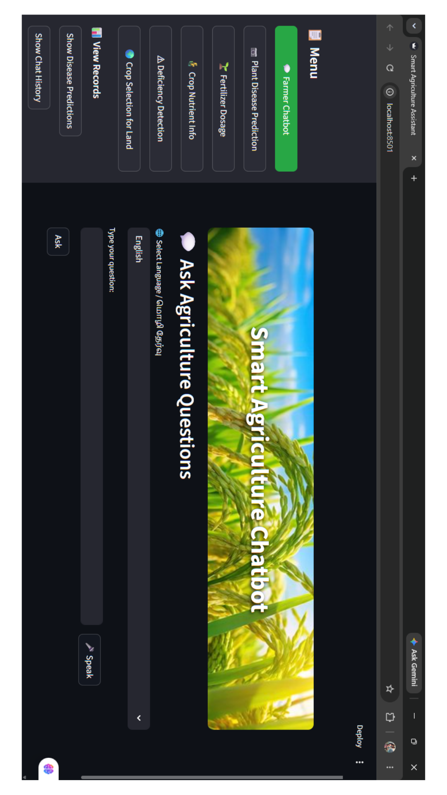
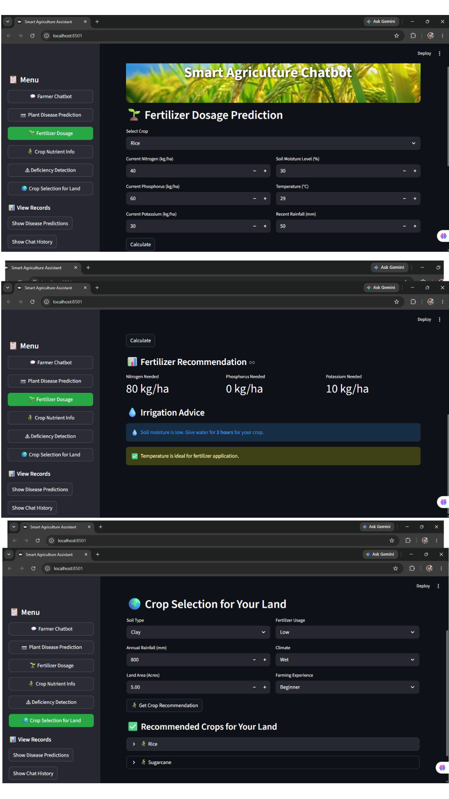

# 🌾 Smart Agricultural Assistant (Agri Assist)

A bilingual (English + Tamil) farmer-support web app built with **Python and Streamlit**. It answers farming questions, checks plant leaves from a photo, and recommends fertilizer, crops and irrigation, all in one simple dashboard. This was a mini project.

## ✨ Features

| Page | What it does |
|---|---|
| 🤖 **Farmer Chatbot** | Answers farming questions by text or voice, in English and Tamil, with spoken replies |
| 🍃 **Plant Disease Prediction** | Upload a leaf photo to get a result (Healthy, Blight, Leaf Spot, or Not a plant) with treatment advice |
| 🧪 **Fertilizer Dosage** | Works out the nutrient gap for a crop and suggests fertilizer and irrigation |
| 📊 **Crop Nutrient Info** | Table of NPK requirements and climate type for 12 crops |
| 🔍 **Deficiency Detection** | Checks soil nutrient levels against crop thresholds |
| 🌱 **Crop Selection** | Suggests crops and estimates yield by soil, climate and farming experience |

It also saves **prediction history** and **chat history** in a local SQLite database (`agriculture.db`), viewable from the sidebar.

## 🖼️ Screenshots





## 🛠️ Tech Stack

- **Python**
- **Streamlit** for the web interface
- **pandas** for crop data
- **SQLite** for storing predictions and chat history
- **gTTS** (Tamil) and **pyttsx3** (English) for text-to-speech

## 🚀 How to Run

1. Clone the repository
   ```bash
   git clone https://github.com/officialmail2hari-hash/Agri_Assist.git
   cd Agri_Assist
   ```
2. Install the dependencies
   ```bash
   pip install streamlit pandas gTTS pyttsx3
   ```
   Voice input also needs a speech-recognition package and a working microphone.
3. Start the app
   ```bash
   streamlit run app.py
   ```
4. Open the address shown in the terminal (usually http://localhost:8501).

## 📁 Project Structure

```
Agri_Assist/
├── app.py            # Streamlit app (chatbot, predictions, recommendations)
├── agriculture.db    # SQLite database (predictions + chat history)
├── farm.jpg          # Header background image
├── Home.png, Home page.png, Work.png, Output.png   # Screenshots
└── README.md
```

## ⚠️ Limitations

- The disease check is a **simple colour-based heuristic**, not a trained machine-learning model, so treat results as a guide only.
- The chatbot answers from a fixed keyword list, so it can't handle questions outside it.

## 🔮 Future Improvements

- Train a real CNN model for plant disease detection
- Add live weather and soil-sensor data
- Support more crops and regional languages

## 👩‍💻 Author

**Harishma M**, B.Sc Data Science
- GitHub: [officialmail2hari-hash](https://github.com/officialmail2hari-hash)
- Email: officialmail2hari@gmail.com
